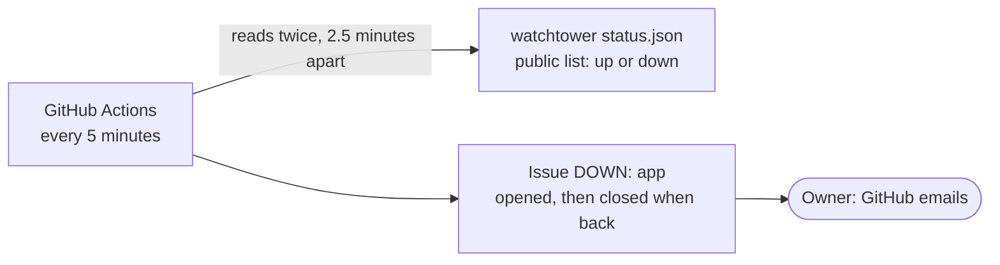

# Uptime alerts: how it is put together

Sends an email within about 5 to 10 minutes when an app stops answering, and another when it is back. Public, so its GitHub check minutes are free; it holds no keys and nothing private. GitHub draws the picture below on this page.

| File | Holds |
|---|---|
| check.mjs | The check |
| .github/workflows/uptime.yml | The schedule: the check every 5 minutes, and the monthly KEEPALIVE.md line |
| KEEPALIVE.md | A dated line each month, so GitHub keeps the schedule on |

## Editable drawings (draw.io)

The same pictures as editable boxes and arrows are in [`architecture.drawio`](architecture.drawio) (one page per picture).
Open it at app.diagrams.net (File › Open from › Device, or from OneDrive) or in the draw.io desktop app.
A copy is kept in OneDrive › Business › Architecture › uptime-alerts.drawio. When a picture above changes, update both copies
(`node tools/to-drawio.mjs` in the ops repo rebuilds the file from this page).
