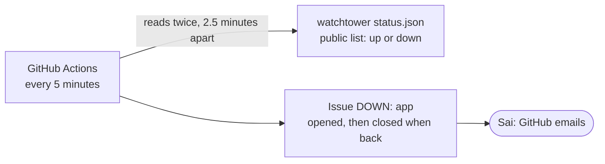

# Uptime alerts: how it is put together

Sends an email within about 5 to 10 minutes when an app stops answering, and another when it is back. Public, so its GitHub check minutes are free; it holds no keys and nothing private. GitHub draws the picture below on this page.

| File | Holds |
|---|---|
| check.mjs | The check |
| KEEPALIVE.md | A dated line each month, so GitHub keeps the schedule on |
